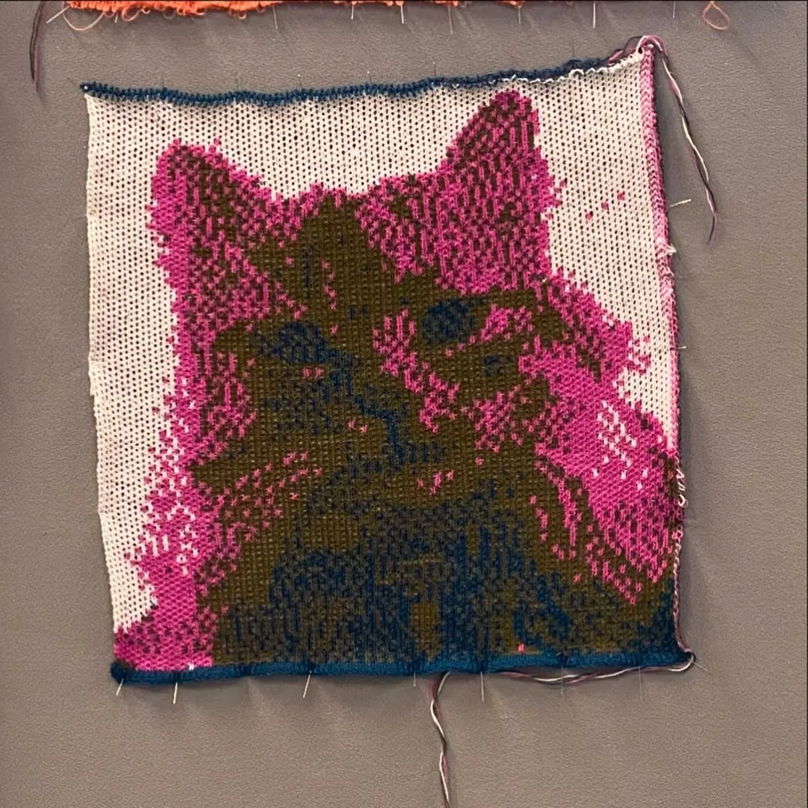
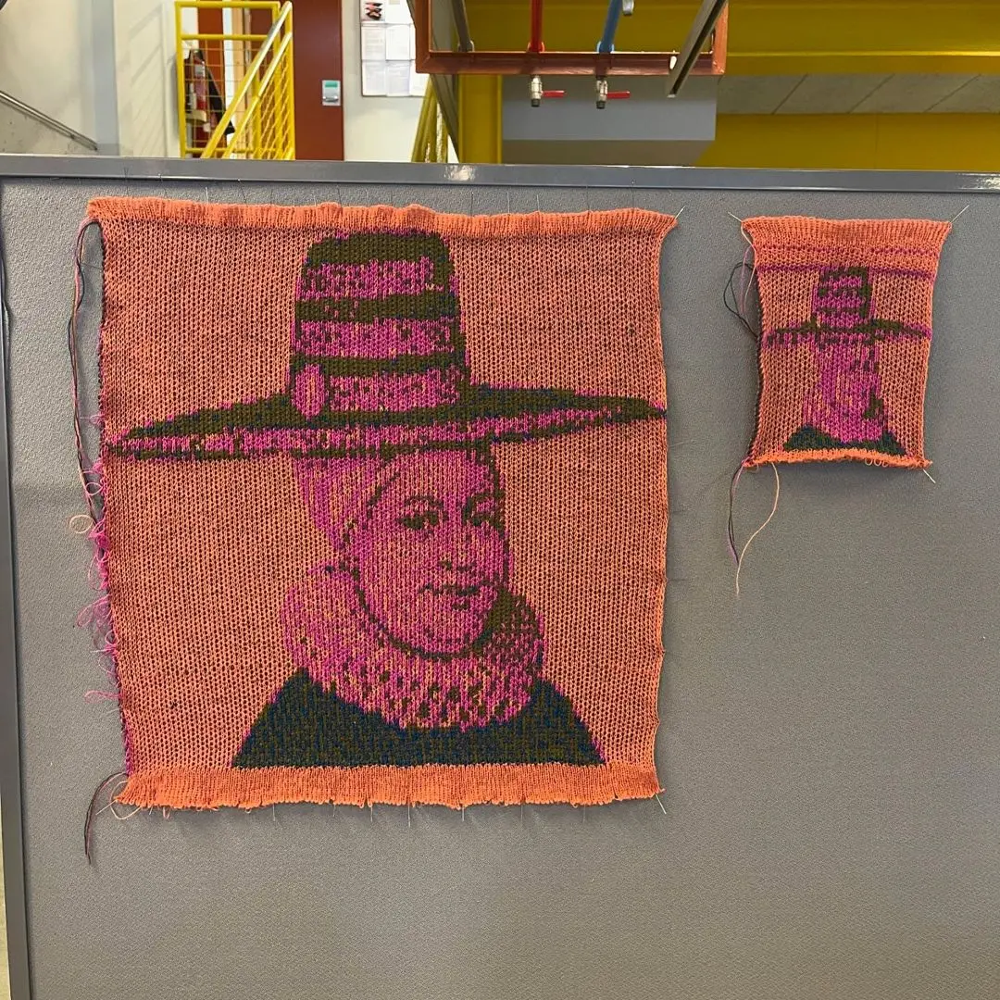

::: {.hnotskurn}
**Í hnotskurn**

Prjón og hönnun voru unnin í nánu samstarfi tölvunarfræðinema og fatahönnuðar. Prufurnar stýrðu hönnunarferlinu og urðu á endanum efniviður í flíkur.
:::

## Hlutverk fatahönnuðarins

Prjón og hönnun lögðu mesta áherslu á hugmyndir, útfærslur og möguleika í prjóni, auk framleiðslu á vélprjóni á *Passap E6000*. Með samstarfinu varð niðurstaðan áhugaverðari og náði betur til hönnuða en ella.

Hlutverk fatahönnuðarins var að veita fagurfræðilega leiðsögn frá sjónarhorni hönnuða. Afurðin var jafnvægi milli skapandi hönnunar, hagnýtra takmarkana vélarinnar og þess sem hægt var að kóða á þessum skamma tíma.

## Hönnunarferlið

Hönnuðurinn studdist við hönnunarhugsun (e. *Design Thinking*) [@designthinking], sem skilgreinir fimm stig:

::: {.skref}
1. **Samkennd** (e. *Empathize*): hvers vegna er hönnunin mikilvæg?
2. **Þarfir** (e. *Define*): þarfir afmarkaðar.
3. **Hugmyndir** (e. *Ideate*): ýmsar aðferðir skoðaðar.
4. **Frumgerð** (e. *Prototype*): hugmyndir afmarkaðar.
5. **Prófun** (e. *Test*): hugmyndir kynntar til að fá viðbrögð frá ólíkum aðilum.
:::

Þegar skýrslan var skrifuð hafði hönnuður náð fjórum stigum.

Þar sem möguleikar uppfærðrar vélar voru óljósir í upphafi var erfitt að sjá lokaútkomuna fyrir. Hönnunarferlið var því sífellt á breytingu og lagði áherslu á möguleikana fremur en lokaútkomu. Prufurnar stýrðu ferlinu að miklu leyti.

> Mistökin kenndu okkur og færðu okkur nær þeim möguleikum sem við getum náð fram í dag.
>
> — úr lokaskýrslunni, *Ferlið sem lærdómstól*

## Ragnheiður og Hallgrímskirkja

Ragnheiður „yngri" Jónsdóttir, sem margir kannast við af 5.000 króna seðlinum, var mikil handverkskona. Hún safnaði í sjónabók sem notuð var í fyrsta kafla *Sjónabókar*. Til að heiðra framlag hennar var mynd af henni fyrsta prjónaða myndin, unnin eftir málverki frá 1684 sem er til sýnis á Þjóðminjasafninu. Málverkið er hópmynd sem Ragnheiður lét mála í Kaupmannahöfn árið 1684, eftir lát eiginmanns síns, Gísla Þorlákssonar biskups. Á henni eru Ragnheiður, Gísli og fyrri eiginkonur hans tvær, Gróa Þorleifsdóttir og Ingibjörg Benediktsdóttir ([Wikipedia](https://en.wikipedia.org/wiki/Ragnhei%C3%B0ur_J%C3%B3nsd%C3%B3ttir), sótt 16. nóvember 2026) [@wiki-ragnheidur].

::: {.par}
{fig-alt="Prjónuð mynd af Ragnheiði, gróf upplausn"}

{fig-alt="Prjónuð mynd af Ragnheiði, fínni upplausn"}
:::

Í framhaldinu var farið að blanda saman myndum og mynstrum, nútíð og fortíð. Hallgrímskirkja var ein þeirra.

{fig-alt="Prjónuð mynd af Hallgrímskirkju með mynstraðan bakgrunn" width=60%}

Náin samvinna tölvunarfræðinema og hönnuðar var lykilatriði í framvindu verkefnisins og býður upp á marga ókannaða möguleika. Meira um mynstrin: [Stafræn Sjónabók](../sjonabok/index.qmd).

## Prufur sem verða að flíkum

Þessi hönnun er undirstaða fatnaðar fyrir Hönnunarmars. Hannaðar voru flíkur sem nýta þær prufur sem þegar höfðu verið prjónaðar, svo þær hefðu notagildi og enduðu síður sem rusl. Leitað var sjálfbærra lausna og lögð áhersla á persónulega og einstaka hönnun.

{fig-alt="Sex teiknaðar fígúrur í prjónuðum peysum úr samsettum prufum"}

## Verkfærin

Hugmyndavinnan fór fram í forritinu [Procreate](https://procreate.com/). Til að fá sem besta útkomu mynda í prjóni voru bæði Procreate og Photoshop notuð, og svo kóðinn til að staðfesta niðurstöður áður en prjónað var. Einnig voru gerðar prufur að stroffi fyrir kraga.

<!-- instagram:start -->

## Af Instagram

Myndir og myndbönd sem teymið birti á [Instagram](https://www.instagram.com/hideftextiles/) meðan á verkefninu stóð. Öll myndböndin eru líka í [spilunarlistanum HiDEF textiles á YouTube](https://www.youtube.com/playlist?list=PLcHERjMhsyhA).

```{=html}
<div class="instagram">
<figure><a href="../img/instagram/prjonavel/2024-07-23_C9xaz9Agxi7_01.webp" class="lightbox" data-gallery="instagram"></a><figcaption>Prjónað eftir ljósmynd og eftir mynd af málverki. <a href="https://www.instagram.com/p/C9xaz9Agxi7/">Færslan á Instagram</a>, 23. júlí 2024.</figcaption></figure>
<figure><a href="../img/instagram/prjonavel/2024-07-23_C9xaz9Agxi7_02.webp" class="lightbox" data-gallery="instagram"></a><figcaption><a href="https://www.instagram.com/p/C9xaz9Agxi7/">Færslan á Instagram</a>, 23. júlí 2024.</figcaption></figure>
</div>
```

<!-- instagram:end -->

::: {.hofundur}
Guðrún Ísafold Hilmarsdóttir. Úr lokaskýrslu verkefnisins [@nsn2024].
:::
