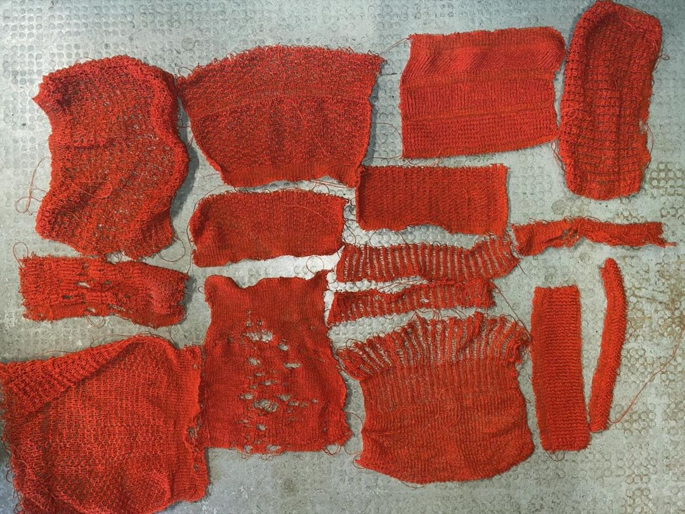
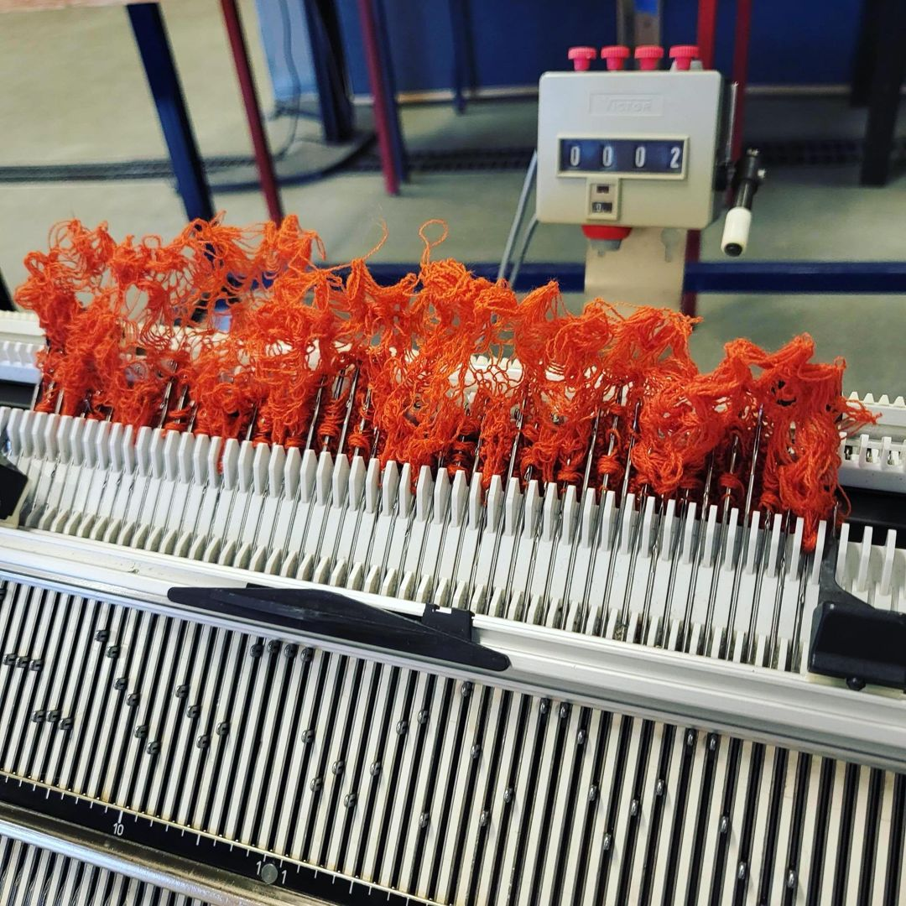

::: {.hnotskurn}
**Í hnotskurn**

Prufurnar byrjuðu í tveimur litum og enduðu í fjórum. Fjórir litir gengu betur þegar aðeins önnur hver lykkja var prjónuð að aftan. Íslenskt einband er gróft garn og þarf sína prjónaáferð.
:::

## Úr tveimur litum í fjóra

::: {.skref}
1. **Tveir litir.** Fyrstu prufur sumarsins voru texti og mynstur í tveimur litum, send á vélina með kóðanum.
2. **Þrír litir.** Með uppfærslu var hægt að prjóna með þremur litum.
3. **Fjórir litir.** Að lokum fjórir. Útkoman varð sífellt áhugaverðari og flóknari.
:::

::: {.callout-warning title="Fjórir litir: breyttu prjóninu"}
Í byrjun gekk illa að prjóna með fjórum litum. Þá voru prjónaðar **8 umferðir á aftara borðinu** fyrir hverja eina umferð á því fremra og það olli miklum vandræðum.

Lausnin var breytt prjón sem prjónar aðeins **aðra hverja lykkju að aftan**. Þá eru prjónaðar **4 umferðir að aftan** fyrir hverja eina að framan.
:::

## Íslenskt einband

Verkefnið fékk einband á kónum frá [Ístex](https://istex.is/). Einband er frekar gróft garn sem hentar almennt ekki vel fyrir prjónavélar. Sem dæmi er ekki hægt að nota einband í [*Kniterate*](https://www.kniterate.com/about/) prjónavélar án þess að það slitni í tíma og ótíma.

Prófaðar voru mismunandi prjónaáferðir til að finna lausn sem hentar einbandi, og eftir sumarið hafði náðst ágætur árangur í því.

## Algeng vandamál

| Hvað gerist? | Af hverju? | Hvað hjálpaði? |
|---|---|---|
| Ójöfn spenna á garni | Spennugjafinn var orðinn misilla farinn fyrir ólíka garnleiðara | Frekari reynsla af vélinni og mótorinn, sem gefur jafnara átak á prjónið |
| Langir spottar á jaðri stykkisins | Tengist spennu garnsins og því hve langt sleðinn ferðast umfram það sem er prjónað | Sama: reynsla og mótorinn |
| Garnið kemst illa á nálarnar og sleðinn festist | Gleymdist að setja strekkjarana aftur á eftir lagfæringu | Setja strekkjarana aftur á |
| Sleðinn prjónar garnlaus og prjónið fellur af | Sleðinn náði ekki að grípa næsta lit | Byrja upp á nýtt eða hengja lykkjurnar aftur á. Þetta kom sem betur fer ekki oft fyrir |
| Hlutur sem heldur garni vantar | | Stykkið var þrívíddarprentað |

## Lærðu á vélina fyrst

Í júní voru prjónaðar ýmsar prufur til að kynnast vélunum. Fyrst voru gerðar prufur úr handbókinni fyrir *Passap Duomatic 80* á þá vél, en seinna á *Passap Electronic 6000*. Báðar vélarnar virka svipað en sú síðari er tengd við tölvuna sem fylgir vélinni.

Prufurnar heppnuðust misvel og í ljós kom að vélarnar eru ekki mjög notendavænar. Fylgt var kennslumyndböndum frá framleiðanda á YouTube til að gera prufur á tölvunni sem fylgdi *Passap E6000*, en þá kom oft upp `ERROR` og þurfti að byrja upp á nýtt.

<!-- instagram:start -->

## Af Instagram

Myndir og myndbönd sem teymið birti á [Instagram](https://www.instagram.com/hideftextiles/) meðan á verkefninu stóð.

```{=html}
<div class="instagram">
<figure><video controls preload="none" playsinline poster="../img/instagram/prjonavel/2024-05-19_C7JRfAQAhQk_01.jpg"><source src="../img/instagram/prjonavel/2024-05-19_C7JRfAQAhQk_01.mp4" type="video/mp4"></video><figcaption>Fyrsta æfingarverkefnið úr Duo80 handbókinni: pottaleppur. <a href="https://www.instagram.com/p/C7JRfAQAhQk/">Færslan á Instagram</a>, 19. maí 2024.</figcaption></figure>
<figure><a href="../img/instagram/prjonavel/2024-05-30_C7oEX5Zg5L2_01.jpg" class="lightbox" data-gallery="instagram"></a><figcaption>Fyrstu prufurnar eftir æfingamynstrum í leiðarvísinum fyrir Duo80. <a href="https://www.instagram.com/p/C7oEX5Zg5L2/">Færslan á Instagram</a>, 30. maí 2024.</figcaption></figure>
<figure><a href="../img/instagram/prjonavel/2024-05-30_C7oPPEUAERo_01.jpg" class="lightbox" data-gallery="instagram"></a><figcaption>Mannleg mistök: hér prjónaðist ekki af nálunum eins og búist var við. <a href="https://www.instagram.com/p/C7oPPEUAERo/">Færslan á Instagram</a>, 30. maí 2024.</figcaption></figure>
</div>
```

<!-- instagram:end -->

::: {.hofundur}
Guðrún Ísafold Hilmarsdóttir. Úr lokaskýrslu verkefnisins [@nsn2024].
:::
