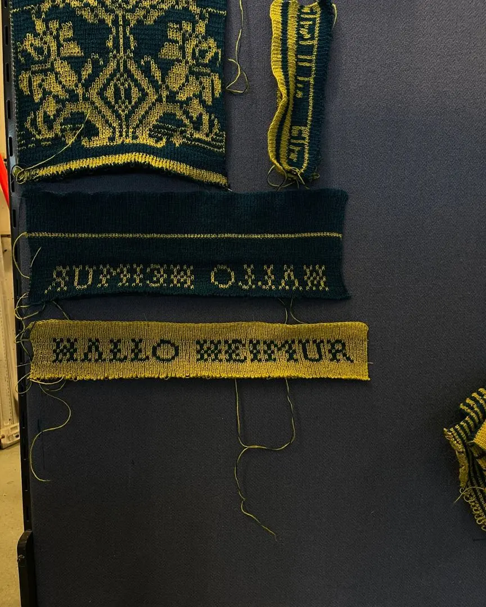
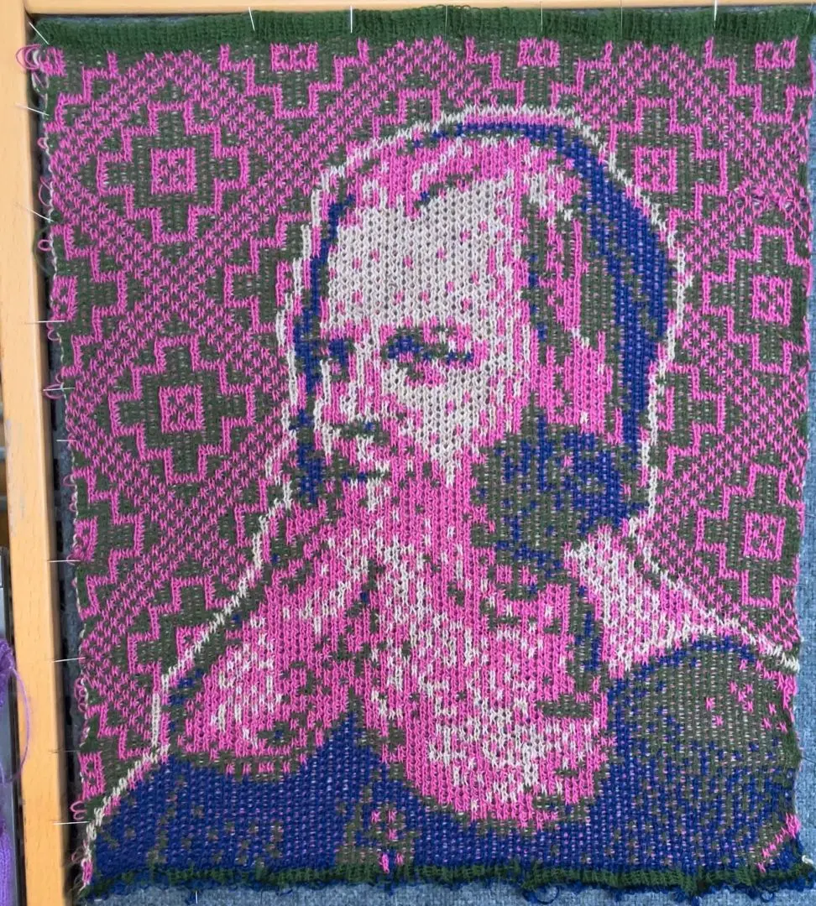
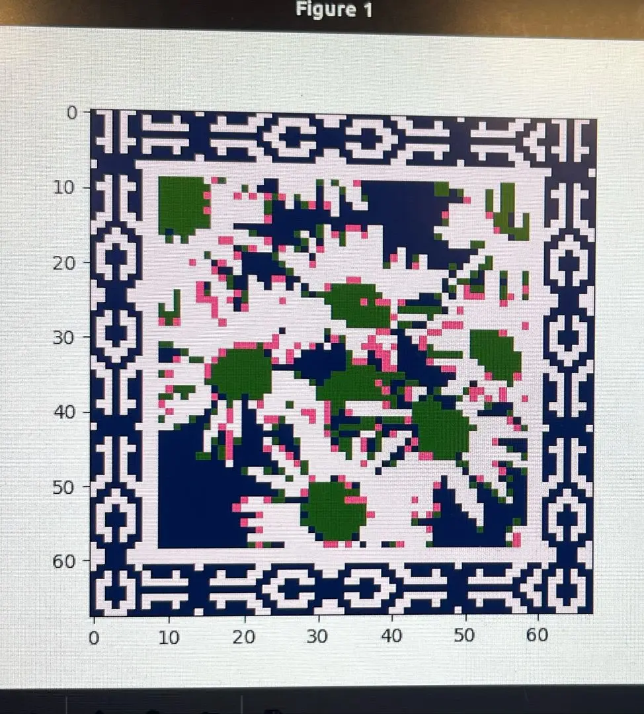
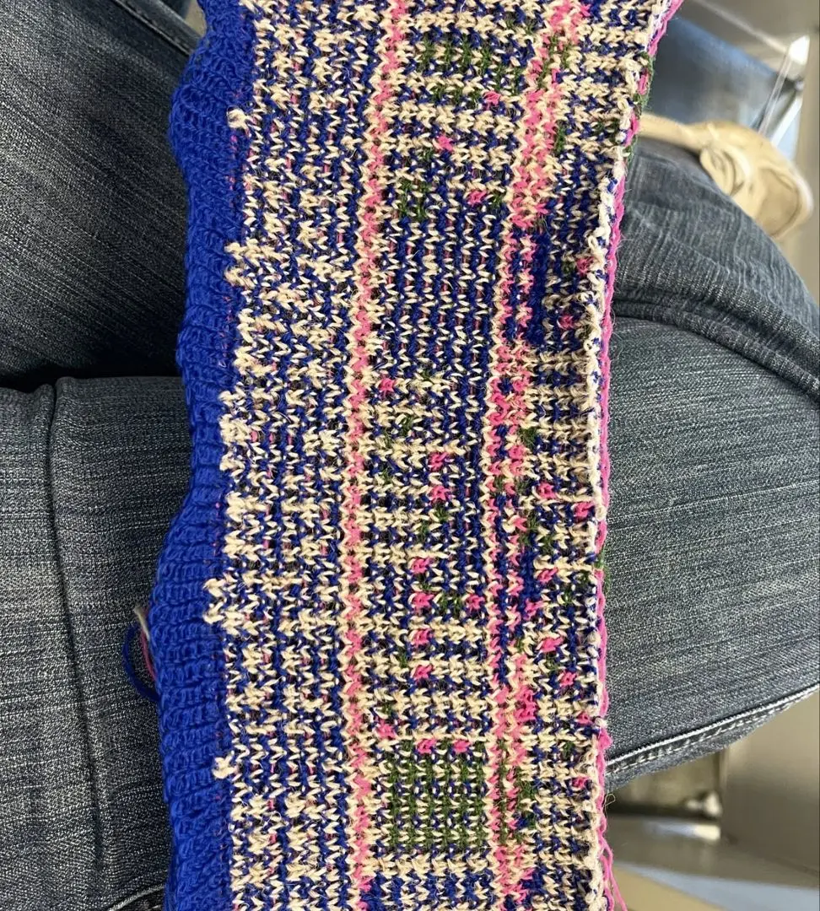

Þrjár af fyrstu prufum sumarsins. Mynstrið úr *Sjónabók* (Þjms. 5898) og sama mynstur prjónað.

::: {.par}
{.pixel fig-alt="Rúðumynstur af páfugli"}

{fig-alt="Prjónaður páfugl"}
:::

::: {.par}
{.pixel fig-alt="Rúðumynstur af blómi"}

{fig-alt="Prjónað blóm"}
:::

::: {.par}
{.pixel fig-alt="Ferningslaga rúðumynstur"}

{fig-alt="Prjónað stykki með endurteknu mynstri"}
:::

::: {.callout-tip title="Ekki bara fyrir prjón"}
Mynstrin eru ekki einskorðuð við prjónaskap. Grafískir hönnuðir geta nýtt þau í textílvinnu eða öðrum miðlum [@nsn2024, kafli *Afleidd tækifæri*].
:::

## Ragnheiður Jónsdóttir

Ragnheiður „yngri" Jónsdóttir safnaði í sjónabók sem notuð var í fyrsta kafla *Sjónabókar*. Til að heiðra framlag hennar var mynd af henni fyrsta myndin sem prjónuð var á vélinni. Síðan var farið að blanda saman myndum og mynstrum. Sjá [Hönnun úr prufum](../prjonavel/honnun.qmd).

{.pixel fig-alt="Mynstur af konu með hatt og mynstraðan bakgrunn"}

<!-- instagram:start -->

## Af Instagram

Myndir og myndbönd sem teymið birti á [Instagram](https://www.instagram.com/hideftextiles/) meðan á verkefninu stóð. Öll myndböndin eru líka í [spilunarlistanum HiDEF textiles á YouTube](https://www.youtube.com/playlist?list=PLcHERjMhsyhA).

```{=html}
<div class="instagram">
<figure><video controls preload="none" playsinline poster="../img/instagram/sjonabok/2024-07-05_C9Cf8FFgDZZ_01.webp"><source src="../img/instagram/sjonabok/2024-07-05_C9Cf8FFgDZZ_01.mp4" type="video/mp4"></video><figcaption>Fyrsta myndin sem heppnaðist vel, tekin úr Íslensku Sjónabókinni. <a href="https://www.instagram.com/p/C9Cf8FFgDZZ/">Færslan á Instagram</a>, 5. júlí 2024.</figcaption></figure>
<figure><a href="../img/instagram/sjonabok/2024-07-08_C9KbfzDI1Wo_01.webp" class="lightbox" data-gallery="instagram"></a><figcaption>Forritið speglaði myndirnar, en því var kippt í lag í hvelli. <a href="https://www.instagram.com/p/C9KbfzDI1Wo/">Færslan á Instagram</a>, 8. júlí 2024.</figcaption></figure>
<figure><video controls preload="none" playsinline poster="../img/instagram/sjonabok/2024-07-08_C9KbfzDI1Wo_02.webp"><source src="../img/instagram/sjonabok/2024-07-08_C9KbfzDI1Wo_02.mp4" type="video/mp4"></video><figcaption><a href="https://www.instagram.com/p/C9KbfzDI1Wo/">Færslan á Instagram</a>, 8. júlí 2024.</figcaption></figure>
<figure><video controls preload="none" playsinline poster="../img/instagram/sjonabok/2024-07-08_C9KbfzDI1Wo_03.webp"><source src="../img/instagram/sjonabok/2024-07-08_C9KbfzDI1Wo_03.mp4" type="video/mp4"></video><figcaption><a href="https://www.instagram.com/p/C9KbfzDI1Wo/">Færslan á Instagram</a>, 8. júlí 2024.</figcaption></figure>
<figure><a href="../img/instagram/sjonabok/2024-08-20_C-5CF7KAgNj_01.webp" class="lightbox" data-gallery="instagram"></a><figcaption>Ýmislegt prjónað. <a href="https://www.instagram.com/p/C-5CF7KAgNj/">Færslan á Instagram</a>, 20. ágúst 2024.</figcaption></figure>
<figure><a href="../img/instagram/sjonabok/2024-08-20_C-5CF7KAgNj_02.webp" class="lightbox" data-gallery="instagram"></a><figcaption><a href="https://www.instagram.com/p/C-5CF7KAgNj/">Færslan á Instagram</a>, 20. ágúst 2024.</figcaption></figure>
<figure><a href="../img/instagram/sjonabok/2024-08-20_C-5CF7KAgNj_03.webp" class="lightbox" data-gallery="instagram"></a><figcaption><a href="https://www.instagram.com/p/C-5CF7KAgNj/">Færslan á Instagram</a>, 20. ágúst 2024.</figcaption></figure>
<figure><iframe src="https://www.youtube-nocookie.com/embed/Ozf-9MO2r8M" title="Ýmislegt prjónað." loading="lazy" allow="accelerometer; encrypted-media; gyroscope; picture-in-picture; web-share" referrerpolicy="strict-origin-when-cross-origin" allowfullscreen></iframe><figcaption><a href="https://www.instagram.com/p/C-5CF7KAgNj/">Færslan á Instagram</a>, 20. ágúst 2024.</figcaption></figure>
</div>
```

<!-- instagram:end -->

::: {.hofundur}
Nemendur verkefnisins. Úr lokaskýrslu verkefnisins [@nsn2024]. Mynstursíðurnar eru úr @Sjonabok (Þjms. 5898).
:::
