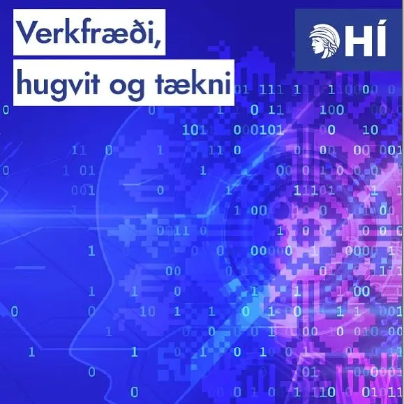
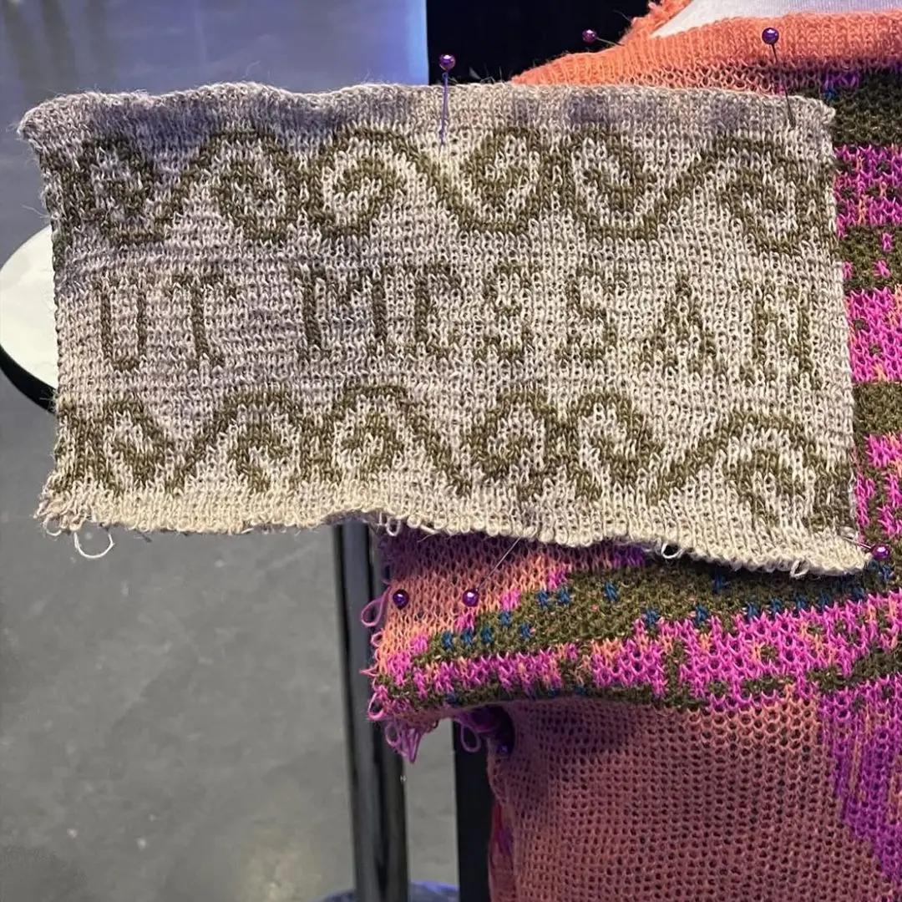
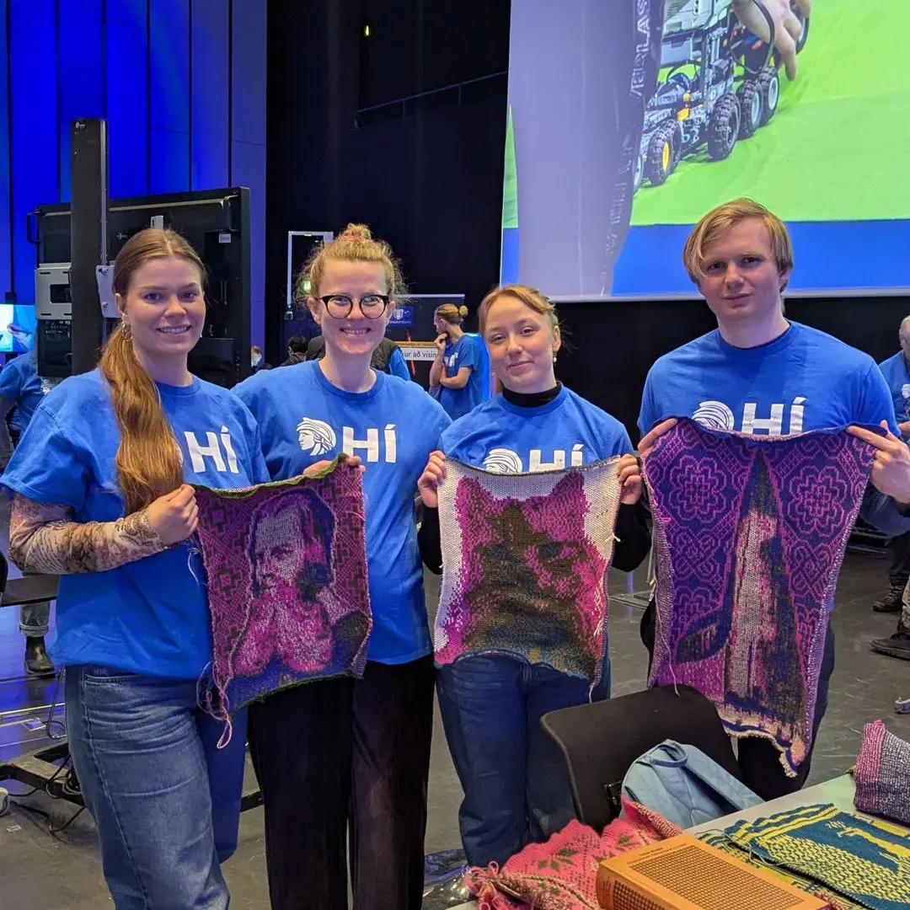
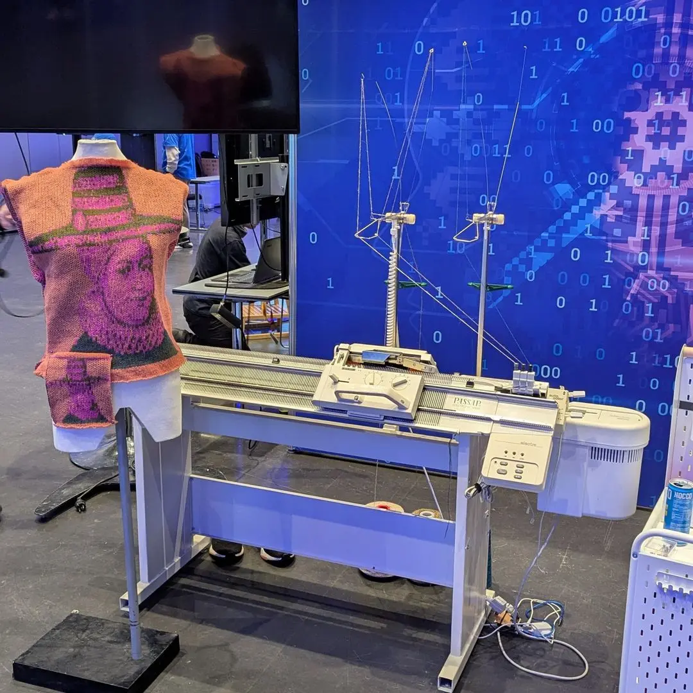
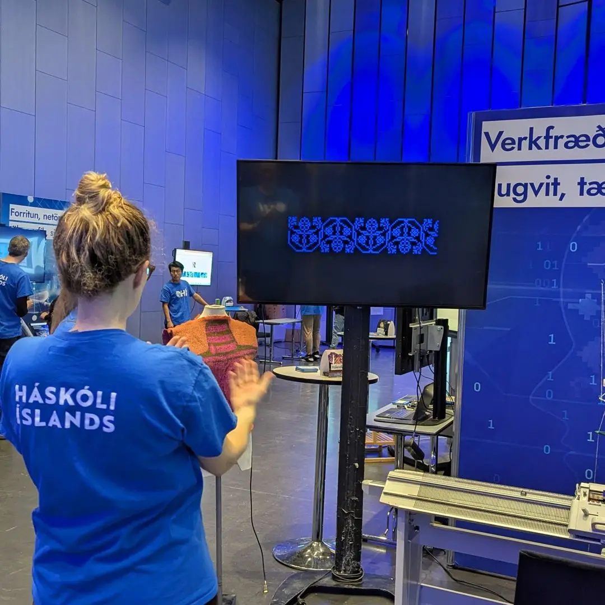
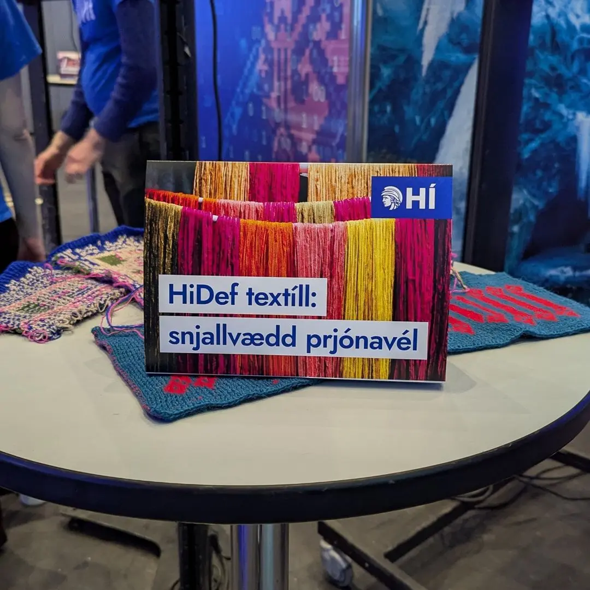

::: {.hnotskurn}
**Í hnotskurn**

*HiDef Textíll: Tæknivæddar prjónavélar* sameinar hefðbundna textílvinnslu og nútímatækni. Úrelt prjónavél frá 10. áratugnum var snjallvædd með netsamskiptum og frjálsum hugbúnaði. Þannig verður til tól sem hentar skapandi starfi nútímans og stuðlar jafnframt að sjálfbærni.
:::

::: {.facts}
::: {}
**2024** maí til september
:::
::: {}
**3** nemendur úr þremur greinum
:::
::: {}
**5** kennarar og leiðbeinendur
:::
::: {}
**9** mannmánuðir frá Nýsköpunarsjóði námsmanna
:::
:::

{fig-alt="Vinnustofa með prjónavél, garni og prjónaprufum á vegg"}

## Um hvað snýst þetta?

Verkefnið er þverfaglegt. Nemendur úr vélaverkfræði, hagnýttri stærðfræði og fatahönnun unnu saman að þróun tækjalausna, verkefnastjórnun og frumgerðasmíði. Markmiðið var að hanna starfhæfa prjónavél sem hægt væri að kynna á viðburðum eins og Hönnunarmars og UTmessunni.

Verkefnið stuðlar að aukinni þátttöku í STEAM menntun, þar sem listir og tækni mætast á nýstárlegan hátt, og varðveitir um leið menningararf í nútímasamhengi. Á Vísindavöku Rannís 28. september 2024 var vélin notuð til að sýna samstarf háskólanna í virku sambandi við atvinnulífið. Hún var aftur sýnd á [UTmessunni](https://utmessan.is/um-okkur/fyrri_utmessur/596-utmessan-2025) 7.–8. febrúar 2025 í Hörpu, sem hluti af bás Háskóla Íslands. Háskóli Íslands var meðal sýnenda [@utmessan2025]; að vélin hafi verið á básnum er samkvæmt Helgu Ingimundardóttur, sem tók þátt fyrir hönd HÍ. Það kemur ekki fram í skýrslunni, sem er frá 2024.

## Sagan í fimm köflum

::: {.cards}
::: {.card-hi}
[1]{.num}

#### [Bakgrunnur](bakgrunnur.qmd)
Markmið, hvað aðrir hafa gert og hvar verkefnið stendur.
:::

::: {.card-hi}
[2]{.num}

#### [Nýnæmi](nynaemi.qmd)
Markaðurinn, áskoranirnar, tækifærin og hugverkastefnan.
:::

::: {.card-hi .teal}
[3]{.num}

#### [Fólkið og samstarfið](teymi.qmd)
Nemendur, kennarar, samstarfsaðilar og fjármögnun.
:::

::: {.card-hi .teal}
[4]{.num}

#### [Verðmæti](verdmaeti.qmd)
Hvað verkefnið gefur samfélaginu.
:::

::: {.card-hi .pink}
[5]{.num}

#### [Sumarið 2024](sumarid.qmd)
Dagbók sumarsins, mánuð fyrir mánuð, og helstu áfangar.
:::
:::

## Afraksturinn

Það sem verkefnið skilaði er orðið að þremur viðfangsefnum á þessum vef:

::: {.cards}
::: {.card-hi .dashed}
#### [Prjónavélin](../prjonavel/index.qmd)
Handbók um vélbúnað, hugbúnað og notkun.
:::

::: {.card-hi .dashed}
#### [Stafræn Sjónabók](../sjonabok/index.qmd)
Íslensk útsaumsmynstur á tölvutæku formi.
:::

::: {.card-hi .dashed}
#### [Mynsturgerð](../mynsturgerd/index.qmd)
Reiknirit sem búa til prjónamynstur.
:::
:::

[Lokaskýrsla (PDF)](../skjol/NSN-2024-lokaskyrsla.pdf){.btn .btn-primary}
[Hvar er hver kafli skýrslunnar?](../heimildir.qmd#skýrslan-á-vefnum){.btn .btn-outline-primary}

<!-- instagram:start -->

## Af Instagram

Myndir og myndbönd sem teymið birti á [Instagram](https://www.instagram.com/hideftextiles/) meðan á verkefninu stóð. Öll myndböndin eru líka í [spilunarlistanum HiDEF textiles á YouTube](https://www.youtube.com/playlist?list=PLcHERjMhsyhA).

```{=html}
<div class="instagram">
<figure><a href="../img/instagram/verkefnid/2025-02-01_DFhlZR0ACh5_01.webp" class="lightbox" data-gallery="instagram"></a><figcaption>HiDef textíll á UTmessunni 8. febrúar 2025 í Hörpu. <a href="https://www.instagram.com/p/DFhlZR0ACh5/">Færslan á Instagram</a>, 1. febrúar 2025.</figcaption></figure>
<figure><a href="../img/instagram/verkefnid/2025-02-08_DF0hT23AiW2_01.webp" class="lightbox" data-gallery="instagram"></a><figcaption>Takk öll sem kíktu á okkur á UTmessunni. <a href="https://www.instagram.com/p/DF0hT23AiW2/">Færslan á Instagram</a>, 8. febrúar 2025.</figcaption></figure>
<figure><a href="../img/instagram/verkefnid/2025-02-14_DGDom8DsFbC_01.webp" class="lightbox" data-gallery="instagram"></a><figcaption>Prjón og gervigreind mætast: frá bás Háskóla Íslands á UTmessunni. <a href="https://www.instagram.com/p/DGDom8DsFbC/">Færslan á Instagram</a>, 14. febrúar 2025.</figcaption></figure>
<figure><a href="../img/instagram/verkefnid/2025-02-14_DGDom8DsFbC_02.webp" class="lightbox" data-gallery="instagram"></a><figcaption><a href="https://www.instagram.com/p/DGDom8DsFbC/">Færslan á Instagram</a>, 14. febrúar 2025.</figcaption></figure>
<figure><a href="../img/instagram/verkefnid/2025-02-14_DGDom8DsFbC_03.webp" class="lightbox" data-gallery="instagram"></a><figcaption><a href="https://www.instagram.com/p/DGDom8DsFbC/">Færslan á Instagram</a>, 14. febrúar 2025.</figcaption></figure>
<figure><a href="../img/instagram/verkefnid/2025-02-14_DGDom8DsFbC_04.webp" class="lightbox" data-gallery="instagram"></a><figcaption><a href="https://www.instagram.com/p/DGDom8DsFbC/">Færslan á Instagram</a>, 14. febrúar 2025.</figcaption></figure>
</div>
```

<!-- instagram:end -->

::: {.hofundur}
Elías Lúðvíksson, Guðrún Ísafold Hilmarsdóttir og Snæfríður Ebba Ásgeirsdóttir, undir stjórn [Helgu Ingimundardóttur](https://hi.is/starfsfolk/helgaingim). Úr lokaskýrslu verkefnisins [@nsn2024].
:::
